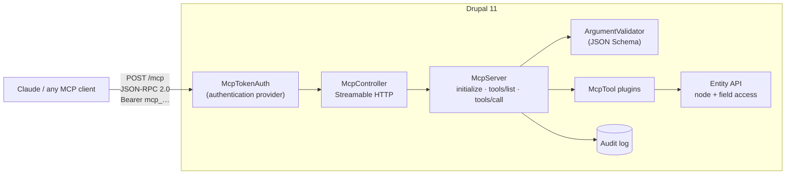

# MCP Gateway for Drupal

**Let AI assistants like Claude work with your Drupal site, safely.**

MCP Gateway turns a Drupal 11 site into a [Model Context Protocol](https://modelcontextprotocol.io) (MCP) server. Claude, Claude Code, or any MCP client can search, read and draft content through a set of tools, and every tool call runs as a real Drupal user, so roles, node access and field access all apply exactly as they do in the browser.

```
You:     "Find our naloxone guidance and draft a one-paragraph summary for the newsletter."
Claude:  → search_content {"query": "naloxone"}
         → get_node {"nid": 6}
         → create_draft {"type": "article", "title": "Newsletter: naloxone outreach", ...}
         "Done. The draft is unpublished and ready for an editor: /node/8/edit"
```

[](../../actions/workflows/ci.yml)


## Why it matters

Organizations want AI help with their content, but they cannot give a model an admin account. MCP Gateway is built around that constraint:

- **The AI is never more powerful than the person using it.** Each token belongs to one Drupal user. The gateway uses Drupal's own authentication and access systems, so it inherits every permission, node grant and field access rule.
- **AI drafts, humans publish.** `create_draft` always saves content unpublished. `update_node` saves a new revision with a log message and never changes publication status, so every AI edit can be reviewed and reverted.
- **Everything is audited.** Each call is logged with the user, tool, arguments, outcome and duration, viewable at *Reports → MCP audit log*.
- **Admins stay in control.** Tools can be switched off site-wide, and each tool has its own permission per role.

## How it works



| Layer | What it does |
|---|---|
| `McpTokenAuth` | A Drupal **authentication provider** for `Authorization: Bearer mcp_…`. Tokens are 192-bit random values; only a SHA-256 hash is stored. Blocked users are rejected immediately. |
| `McpController` | MCP [Streamable HTTP](https://modelcontextprotocol.io/specification/2025-11-25/basic/transports) endpoint. Returns `401` with `WWW-Authenticate` when unauthenticated, `202` for notifications, and checks `Origin` to block DNS-rebinding attacks. |
| `McpServer` | Transport-independent JSON-RPC 2.0 handler. Negotiates protocol versions `2025-11-25`, `2025-06-18` and `2025-03-26`. Tool failures go back to the model as `isError` results it can recover from; internal exceptions are logged, never leaked. |
| `McpTool` plugins | Each tool is a plugin discovered by a PHP attribute, so any module can add tools. |

## Tools

| Tool | Type | What it does |
|---|---|---|
| `site_info` | read | Site name, Drupal version, content counts, and which user the assistant acts as. |
| `list_content_types` | read | Content types, and whether the user may create each. |
| `search_content` | read | Search titles and bodies; returns only content the user may view, with summaries. |
| `get_node` | read | One item in full: body as plain text plus every field the user may view. |
| `create_draft` | write | New content, **always unpublished**, owned by the user, with a revision log. |
| `update_node` | write | Edit title or body as a **new revision**; respects "edit own/any" permissions. |

Tools return both readable JSON text and MCP `structuredContent`, and carry `readOnlyHint` / `idempotentHint` annotations so clients can ask for confirmation before write operations.

## Install

```bash
# In your Drupal 11 project
git clone https://github.com/<you>/drupal-mcp-server web/modules/custom/mcp_gateway
drush en mcp_gateway
```

1. **Grant permissions** at *People → Permissions*: "Connect AI assistants via MCP" plus one permission per tool (for example, give editors `create_draft`, and reviewers only the read tools).
2. **Create a token**: each user opens the **MCP tokens** tab on their profile (`/user/{uid}/mcp-tokens`), picks an expiry, and copies the token. It is shown once.
3. **Optional settings** at *Configuration → Web services → MCP Gateway*: enable or disable tools, cap search results, set audit retention, allow browser origins.

## Connect an AI assistant

**Claude Code**

```bash
claude mcp add --transport http drupal https://your-site.example/mcp \
  --header "Authorization: Bearer mcp_your_token"
```

**Claude Desktop** (`claude_desktop_config.json`, using the `mcp-remote` bridge)

```json
{
  "mcpServers": {
    "drupal": {
      "command": "npx",
      "args": ["-y", "mcp-remote", "https://your-site.example/mcp",
               "--header", "Authorization: Bearer mcp_your_token"]
    }
  }
}
```

**Any client, in code**: see [`examples/sdk-client.mjs`](examples/sdk-client.mjs), which uses the official MCP TypeScript SDK.

```bash
cd examples && npm install
MCP_URL=https://your-site.example/mcp MCP_TOKEN=mcp_… npm run demo
```

**Raw HTTP**

```bash
curl -s https://your-site.example/mcp \
  -H "Authorization: Bearer mcp_your_token" -H "Content-Type: application/json" \
  -d '{"jsonrpc":"2.0","id":1,"method":"tools/call","params":{"name":"search_content","arguments":{"query":"grant"}}}'
```

## Add your own tool

Drop a class into any module's `src/Plugin/McpTool/` directory. It appears in `tools/list`, gets its own permission, and is validated and audited automatically.

```php
namespace Drupal\my_module\Plugin\McpTool;

use Drupal\Core\Session\AccountInterface;
use Drupal\Core\StringTranslation\TranslatableMarkup;
use Drupal\mcp_gateway\Attribute\McpTool;
use Drupal\mcp_gateway\McpToolBase;

#[McpTool(
  id: 'count_open_requests',
  label: new TranslatableMarkup('Count open requests'),
  description: 'Number of open technical assistance requests, optionally for one state.',
)]
final class CountOpenRequests extends McpToolBase {

  public function getInputSchema(): array {
    return [
      'type' => 'object',
      'properties' => ['state' => ['type' => 'string', 'description' => 'Two-letter code']],
      'additionalProperties' => FALSE,
    ];
  }

  public function execute(array $arguments, AccountInterface $account): array {
    $query = $this->entityTypeManager->getStorage('node')->getQuery()
      ->accessCheck(TRUE)
      ->condition('type', 'ta_request')
      ->condition('field_status', 'open');
    if (!empty($arguments['state'])) {
      $query->condition('field_state', $arguments['state']);
    }
    return ['open_requests' => (int) $query->count()->execute()];
  }

}
```

## Quality

- **31 PHPUnit tests, 373 assertions**: unit (schema validation), kernel (every tool, permission matrix, hidden-content leaks, audit log, tokens) and functional (real HTTP requests, token UI, admin pages).
- **Verified with the official MCP SDK** (`@modelcontextprotocol/sdk`) against a live Drupal 11 site.
- **Drupal and DrupalPractice coding standards**: zero errors (`phpcs --standard=phpcs.xml.dist`).
- **GitHub Actions CI** on stable Drupal 11 and the 11.x development branch.
- Built on current Drupal 11 APIs: PHP attribute plugin discovery, object-oriented `#[Hook]` implementations, autowired services and constructor property promotion.

Run the tests locally from your Drupal project root:

```bash
export SIMPLETEST_DB=sqlite://localhost//tmp/test.sqlite SIMPLETEST_BASE_URL=http://127.0.0.1:8080
php -S 127.0.0.1:8080 -t web web/.ht.router.php &
vendor/bin/phpunit -c web/core --testdox web/modules/custom/mcp_gateway/tests
```

## Security notes

- Tokens are bearer credentials: use HTTPS, prefer expiring tokens, and revoke them from the profile tab. Deleting a user deletes their tokens.
- Hidden and nonexistent content return the same message, so the gateway never confirms that content a user cannot see exists.
- Long argument values are truncated in the audit log so it does not become a second copy of your content.
- Unknown arguments are rejected (`additionalProperties: false`), and all queries go through the Entity API with access checks.

## Roadmap

- MCP **resources** for content types and taxonomies
- Media and taxonomy tools
- OAuth 2.1 authorization (MCP auth spec) alongside personal tokens
- Content moderation integration (submit drafts into an editorial workflow state)

## License

GPL-2.0-or-later, the same as Drupal.

Built by [Jeet Parekh](https://www.linkedin.com/in/jeetparekh16).
